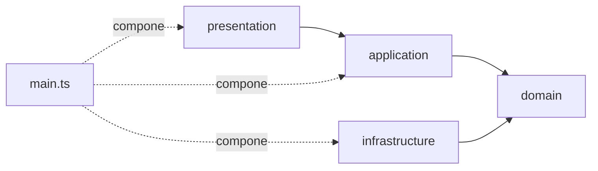

# Clean Weather App

Aplicación web que muestra el clima actual de cualquier ciudad del mundo. Está construida con **TypeScript** y **Vite**, y su objetivo principal es practicar **Arquitectura Limpia** consumiendo una API externa, con foco en la **regla de dependencias hacia adentro**.

> Proyecto de aprendizaje: prioriza un código claro y una separación de responsabilidades bien definida sobre la cantidad de funcionalidades.

---

## Características

- Búsqueda del clima por nombre de ciudad (clic en el botón o tecla **Enter**).
- Muestra ciudad, país, temperatura (°C), descripción del clima y velocidad del viento (km/h).
- Manejo explícito de tres situaciones: ciudad encontrada, ciudad inexistente y error (campo vacío o fallo de red).
- Botón desactivado mientras se consulta, para evitar peticiones duplicadas.
- Los datos externos se pintan con `textContent` y `createElement`, nunca con `innerHTML`, para evitar inyección de HTML (XSS).

---

## Tecnologías

| Herramienta | Uso |
|---|---|
| [TypeScript](https://www.typescriptlang.org/) | Lenguaje principal |
| [Vite](https://vite.dev/) (plantilla `vanilla-ts`) | Servidor de desarrollo y empaquetado |
| [Open-Meteo](https://open-meteo.com/) | API de geocoding y clima (gratuita, sin API key) |
| [Prettier](https://prettier.io/) | Formato de código |
| HTML + CSS | Interfaz, sin frameworks |

---

## Requisitos previos

- [Node.js](https://nodejs.org/) (desarrollado con la versión 24)
- npm (incluido con Node.js)
- Git

---

## Instalación y uso

```bash
# 1. Clonar el repositorio
git clone <URL-DEL-REPOSITORIO>
cd clean-weather-app

# 2. Instalar dependencias
npm install

# 3. Iniciar el servidor de desarrollo
npm run dev
```

Abre en el navegador la dirección que muestra Vite (normalmente `http://localhost:5173`).

### Scripts disponibles

| Comando | Descripción |
|---|---|
| `npm run dev` | Inicia el servidor de desarrollo con recarga automática |
| `npm run build` | Revisa los tipos y genera la versión de producción en `dist/` |
| `npm run preview` | Sirve localmente la versión de producción para probarla |

---

## Arquitectura

El proyecto sigue una Arquitectura Limpia simplificada, sin la complejidad completa de DDD. La idea central: **las dependencias apuntan siempre hacia adentro**. Las capas externas conocen a las internas, nunca al revés.



### Estructura de carpetas

```
src/
├── domain/                 # Entidades e interfaces (no depende de nada)
│   ├── Weather.ts
│   └── WeatherRepository.ts
├── application/            # Casos de uso
│   └── GetWeatherByCity.ts
├── infrastructure/         # Detalles externos: fetch a Open-Meteo
│   └── OpenMeteoWeatherRepository.ts
├── presentation/           # Manejo del HTML/DOM
│   └── WeatherView.ts
├── main.ts                 # Composición: conecta todas las piezas
└── style.css               # Estilos
```

### Responsabilidad de cada capa

| Capa | Responsabilidad | Conoce a |
|---|---|---|
| **domain** | Define *qué es* un clima para la app (`Weather`) y qué necesita de afuera (`WeatherRepository`). | Nadie |
| **application** | Caso de uso `GetWeatherByCity`: valida la ciudad (quita espacios, rechaza texto vacío) y pide el clima al repositorio. | `domain` |
| **infrastructure** | Implementa `WeatherRepository` con `fetch` a Open-Meteo y traduce el JSON de la API a la entidad `Weather`. | `domain` |
| **presentation** | Lee lo que escribe el usuario, llama al caso de uso y pinta el resultado o el mensaje correspondiente. | `application`, `domain` |
| **main.ts** | Único lugar donde se crean las clases concretas y se inyectan unas en otras. | Todas |

### Flujo de una búsqueda

1. El usuario escribe una ciudad y pulsa **Buscar** (o Enter).
2. `WeatherView` llama a `GetWeatherByCity.execute(city)`.
3. El caso de uso limpia el texto con `trim()`. Si queda vacío, lanza un error.
4. Si es válido, llama a `WeatherRepository.getByCity(city)`.
5. `OpenMeteoWeatherRepository` consulta el **geocoding** (nombre → latitud y longitud).
6. Con esas coordenadas consulta el **forecast** (clima actual).
7. Traduce la respuesta a un objeto `Weather`, convirtiendo el código del clima (`weathercode`) en texto legible.
8. `WeatherView` pinta la tarjeta con el resultado.

---

## Decisiones de diseño

- **Interfaz en el dominio, implementación en infraestructura.** `WeatherRepository` es un contrato. Así se puede cambiar Open-Meteo por otra API reescribiendo una sola clase, o probar el caso de uso con un repositorio falso sin necesidad de internet.
- **`null` y `throw` significan cosas distintas.**
  - `null`: la ciudad no existe (resultado normal, se revisa con `if`).
  - `throw`: texto vacío o fallo de red (situación excepcional, se atrapa con `try/catch`).

  Así la capa de presentación puede mostrar mensajes diferentes en cada caso.
- **El dominio solo tiene lo que la pantalla necesita** (YAGNI). `Weather` no copia el JSON de Open-Meteo, sino lo que la app entiende por clima.
- **La traducción de códigos es un detalle de infraestructura.** El significado de `weathercode` (estándar WMO) pertenece a Open-Meteo, por lo que el dominio solo recibe un `description: string`.
- **Tipos de la API dentro de `infrastructure`.** Las interfaces que describen el JSON de Open-Meteo no se exportan: solo las usa esa capa.
- **Seguridad en el DOM.** Los datos que vienen de la API se insertan con `textContent`, no con `innerHTML`.

---

## Convenciones

- **Código en inglés, comentarios en español.**
- Los mensajes que ve el usuario están en español.
- Imports de interfaces con `import type` (lo exige la configuración de TypeScript de Vite).
- Sin *parameter properties* (`constructor(private x: X)`), porque la opción `erasableSyntaxOnly` está activa: los campos se declaran en la clase y se asignan con `this`.
- Formato con Prettier: punto y coma, comillas dobles, 2 espacios de indentación y comas finales (`trailingComma: all`).

---

## API utilizada

[Open-Meteo](https://open-meteo.com/) no requiere API key.

**Geocoding** (nombre de ciudad → coordenadas):

```
https://geocoding-api.open-meteo.com/v1/search?name=Lima&count=1&language=es
```

**Clima actual** (coordenadas → datos):

```
https://api.open-meteo.com/v1/forecast?latitude=-12.04&longitude=-77.03&current_weather=true&timezone=auto
```

---

## Posibles mejoras

- Pruebas unitarias de `GetWeatherByCity` con un repositorio falso.
- Historial de ciudades buscadas.
- Ampliar la tabla de códigos de clima.
- Cambiar la vista por una de consola, tocando solo `presentation` y `main.ts`, como demostración de la arquitectura.

---

## Qué se practicó en este proyecto

- Regla de dependencias hacia adentro e inversión de dependencias.
- Inyección de dependencias por constructor.
- Consumo de APIs con `fetch`, `async/await` y `try/catch/finally`.
- Tipado de respuestas externas y traducción a entidades propias.
- Manejo del DOM con TypeScript de forma segura.